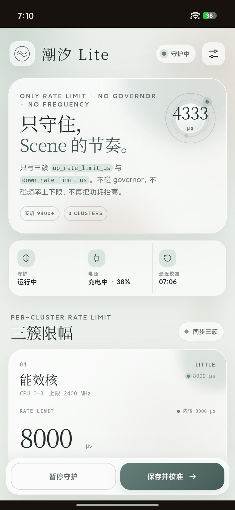
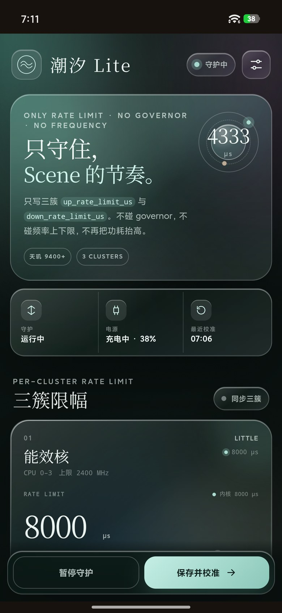
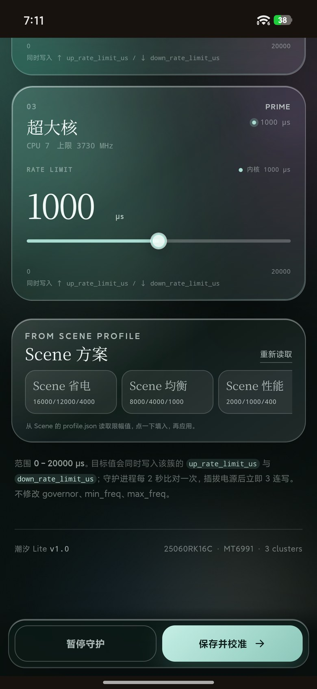

# 潮汐 Lite · Scene Rate Guard

> 只守护 MediaTek `sugov_ext` 的 `up_rate_limit_us` / `down_rate_limit_us`。  
> 不修改 governor，不修改 `scaling_min_freq` / `scaling_max_freq`。

一个面向 **Redmi K80 Ultra（dali / 25060RK16C）** 的 KernelSU 模块。它解决的是 Scene 参数在充电器拔出、亮屏、重启后被系统或电源 HAL 覆盖的问题；同时修正旧版模块把频率上限抬回满频导致的高功耗。



## 为什么需要它

这台机器的 CPU 调频节点实际是：

```text
/sys/devices/system/cpu/cpufreq/policy0/sugov_ext/up_rate_limit_us
/sys/devices/system/cpu/cpufreq/policy0/sugov_ext/down_rate_limit_us
/sys/devices/system/cpu/cpufreq/policy4/sugov_ext/up_rate_limit_us
/sys/devices/system/cpu/cpufreq/policy4/sugov_ext/down_rate_limit_us
/sys/devices/system/cpu/cpufreq/policy7/sugov_ext/up_rate_limit_us
/sys/devices/system/cpu/cpufreq/policy7/sugov_ext/down_rate_limit_us
```

不是 `rate_limit_us`。旧版 `rate_limit_guard` 写入了不存在的节点，同时还尝试写 governor 和三簇频率上下限；频率写入被内核拒绝后，整个应用返回 `write_failed`，并且把 Scene 原本较低的最高频率恢复成满频，功耗自然更高。

潮汐 Lite 只做一件事：**把三簇的升/降频限幅按住**。

## 工作原理

```text
┌──────────────────────────────┐
│ 每 2 秒读取三簇 up/down 节点 │
└──────────────┬───────────────┘
               │ 值不一致 / 事件触发
               ▼
┌──────────────────────────────┐
│ 同时写入同一簇的 up 与 down  │
│ 写后回读校验                  │
└──────────────┬───────────────┘
               │
               ▼
        日志 + 回写计数
```

### 事件触发

| 时机 | 行为 |
|---|---|
| 开机满 60 秒 | 启动守护并做第一次校准 |
| 充电器接入/拔出 | 检测 `online/status` 变化，立即执行 3 连写（0s / 0.3s / 0.9s） |
| 息屏 → 亮屏 | 由 2 秒校验兜底，覆盖亮屏后系统重写 |
| 电量 ≤ 5% | 每 30 秒检查一次，跨过门槛时强制写一次；高于 7% 复位 |
| 日常 | 每 2 秒比对，只在值不一致时写入，稳定时零写入 |

### 只碰 rate limit

模块不修改：

- `scaling_governor`
- `scaling_min_freq`
- `scaling_max_freq`
- CPU online / cpuset / GPU

因此不会再把 Scene 的频率上限覆盖掉，也不会和 Scene 的 governor 抢控制权。

## Scene 预设

WebUI 会读取 Scene 的：

```text
/data/data/com.omarea.vtools/files/profile.json
```

解析其中的 rate limit 字段，生成三个预设：

| Scene 方案 | cluster 0 | cluster 1 | cluster 2 |
|---|---:|---:|---:|
| 省电 `powersave` | 16000 | 12000 | 4000 |
| 均衡 `balance` | 8000 | 4000 | 1000 |
| 性能 `performance` | 2000 | 1000 | 400 |

单位均为 µs。点预设填入，再点「应用并守护」。Scene 的 `fast` 方案使用 `performance` governor，没有 rate 字段，因此不会出现在预设里。

> 模块会持续守住最后一次应用的值。若在 Scene 里切换了模式，请回到 WebUI 点对应的 Scene 预设再应用。

## 适配范围

### 已验证

| 项目 | 值 |
|---|---|
| 机型 | Redmi K80 Ultra |
| 型号 / 代号 | 25060RK16C / `dali` |
| SoC | MediaTek Dimensity 9400+ / `MT6991` |
| 系统 | HyperOS 3 / Android 16（真机为定制版） |
| Root | KernelSU `3.2.5` |
| WebUI | KsuWebUI |

真机验证内容：

- 三簇 `up/down_rate_limit_us` 可写、可回读；
- 守护运行中将三簇改成 `10/10`，下一轮被恢复为 `8000/4000/1000`；
- 开机满 60 秒启动守护；
- 充电器状态变化触发重新写入；
- WebUI 读取 Scene 预设、应用参数、暂停/恢复。

### 条件兼容

- MediaTek 平台，内核实际暴露 `sugov_ext/up_rate_limit_us` 与 `sugov_ext/down_rate_limit_us`；
- 当前 governor 为 `sugov_ext`；
- KernelSU / KernelSU Next / SukiSU；标准 Magisk 可以运行脚本，但没有 KernelSU WebUI；
- Android 14–16 中具备上述节点和 KernelSU WebUI 的环境。

### 不适用

- 内核没有 `up_rate_limit_us` / `down_rate_limit_us`；
- 非 MediaTek 平台，或调频器不是 `sugov_ext`；
- 需要模块修改 governor、频率范围、GPU、cpuset 的场景；
- 无 Root 环境。

> 不同机型、内核版本即使同为天玑 9400+，节点数量和 SELinux 权限也可能不同；安装前请先运行下方“节点检查”。

## 安装

1. 在 KernelSU 管理器中禁用或卸载旧模块 `rate_limit_guard`，避免它继续写 governor/频率。
2. 安装 [`release/scene_rate_guard-v1.0.0.zip`](release/scene_rate_guard-v1.0.0.zip)。
3. 重启手机。
4. 打开模块 WebUI。
5. 选择 Scene 省电 / 均衡 / 性能，或手动填写三簇数值。
6. 点「应用并守护」。

### 首次使用建议

- 如果当前 Scene 是均衡，选 **Scene 均衡**，值为 `8000 / 4000 / 1000`；
- 如果当前 Scene 是省电，选 **Scene 省电**，值为 `16000 / 12000 / 4000`；
- 使用自定义值时，范围是 `0–20000 µs`。

## 界面

<table>
  <tr>
    <td></td>
    <td></td>
    <td></td>
  </tr>
</table>

- 只保留 rate limit 相关控件；
- 去掉震动与触感设置；
- 去掉 governor 和频率调节；
- 滑条用 `requestAnimationFrame` 合帧更新；
- 5 套莫奈配色 + **液态玻璃**风格；
- 内置壁纸、自定义壁纸上传、字体选择。

## 目录

```text
.
├── module/                  # 模块源码
│   ├── bin/scene_guard.sh   # 守护与写入逻辑
│   ├── webroot/             # WebUI
│   ├── customize.sh
│   ├── service.sh
│   ├── uninstall.sh
│   └── module.prop
├── release/                 # 可安装 ZIP 与 SHA-256
├── docs/screenshots/        # 真机截图
└── scripts/package.sh       # 重新打包脚本
```

## 排错

### 没有找到节点

```sh
su -c 'find /sys/devices/system/cpu/cpufreq -name "*rate_limit_us"'
su -c 'for p in /sys/devices/system/cpu/cpufreq/policy*; do
  echo "=== $p"
  cat "$p/scaling_governor"
  ls -l "$p/sugov_ext" 2>/dev/null
done'
```

### 写入失败

```sh
su -c 'tail -n 80 /data/adb/scene_rate_guard/guard.log'
su -c 'dmesg | grep avc | tail -40'
```

### Scene 预设不显示

```sh
su -c 'ls -l /data/data/com.omarea.vtools/files/profile.json'
```

如果文件不存在，仍可在 WebUI 手动填写三簇值。

### 查看当前运行状态

```sh
su -c 'cat /data/adb/scene_rate_guard/config.conf'
su -c 'cat /data/adb/scene_rate_guard/values.conf'
su -c 'tail -n 30 /data/adb/scene_rate_guard/guard.log'
```

## 构建

```sh
cd module
zip -r ../release/scene_rate_guard-v1.0.0.zip \
  module.prop customize.sh service.sh uninstall.sh README.md bin webroot
sha256sum ../release/scene_rate_guard-v1.0.0.zip
```

或者运行：

```sh
bash scripts/package.sh
```

## 版本

### v1.0.0

- 首次发布；
- 只管理 `up/down_rate_limit_us`；
- 修复旧版 `rate_limit_us` 路径错误与频率写入失败；
- Scene 省电/均衡/性能预设；
- 液态玻璃主题；
- 移除震动、触感设置、governor 与频率调节。

## English

**Tide Lite · Scene Rate Guard** is a KernelSU module for the Redmi K80 Ultra (`dali`, Dimensity 9400+ / MT6991). It only rewrites the per-cluster `sugov_ext` `up_rate_limit_us` and `down_rate_limit_us` values. It never changes the governor or frequency limits.

It verifies the six rate nodes every two seconds, re-applies after charger changes, and starts guarding 60 seconds after boot. Scene `profile.json` presets for powersave, balance, and performance are available in the WebUI. Tested on HyperOS 3 / Android 16 with KernelSU 3.2.5.

## 致谢

- [Scene](https://vtools.omarea.com/)：提供 profile 结构和调频思路；
- [KernelSU](https://kernelsu.org/)：模块与 WebUI 运行环境；
- 真机测试：Redmi K80 Ultra / HyperOS 3。
